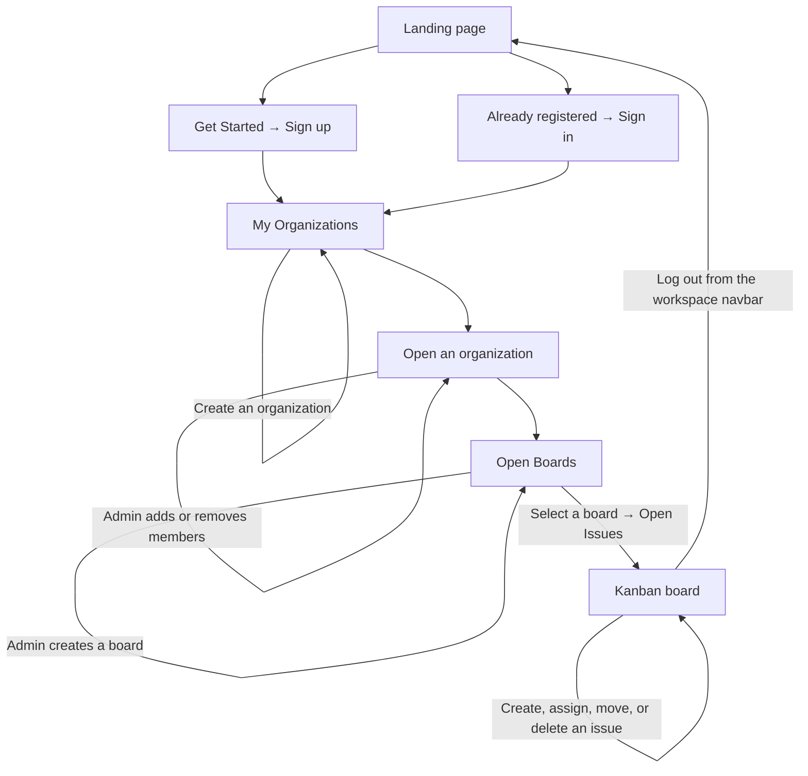
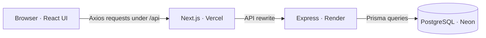
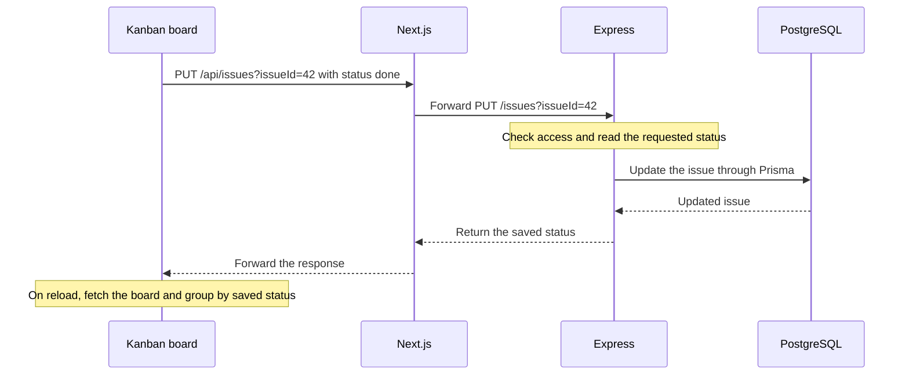

# TaskFlow

TaskFlow is a task tracker for small teams. Create an organization, add teammates by username, and use Kanban boards to assign issues and track their progress.

[Live demo](https://taskflow-v0001.vercel.app/) · [deployment.readme.md](./deployment.readme.md)

## Screenshots

## How TaskFlow works

1. **Create an account or sign in.** Get Started opens the signup form. Submitting that form or the sign-in form starts a session and takes you to My Organizations.
2. **Pick or create an organization.** The directory shows organizations you administer or belong to. Open one to see its description, admin, and member list. If you’re the admin, you can add and remove members here.
3. **Open a board.** The organization’s Boards page lists its boards. The admin can create a board there, and members can open an existing board.
4. **Work on issues.** Open Issues loads that board’s Kanban. Create an issue with an assignee and priority, move it through **Up Next**, **In Progress**, and **Done**, or delete it.
5. **Log out.** The workspace navbar ends the current session and sends you back to the landing page.

## Features

- **Sign up and sign in.** Create an account or return to your workspace with your username and password.
- **Access and refresh tokens.** The API uses a short-lived access token for protected requests and rotates the refresh token when renewing the session. Both are carried in HTTP-only cookies.
- **Multi-device sign-in.** Sign in on a laptop and a phone at the same time. Each sign-in gets its own refresh token.
- **Log out of the current session.** Confirm logout from the workspace navbar. The API revokes that session’s refresh token and clears the cookies. The browser returns to the landing page and sessions on other devices stay active.
- **Organizations and members.** Create an organization, see the organizations you belong to, and open their details and member lists. Admins can add or remove existing users by username.
- **Boards.** Admins can create boards inside their organization. Members can open those boards and work on the issues.
- **Issues.** Create an issue, assign it to an organization member, set its priority to Low, Medium, or High, and see its assignee and creation date on the card. Delete the issue when it’s no longer needed.
- **Kanban.** Move an issue between **Up Next**, **In Progress**, and **Done**. The API saves the destination so it appears in the same column after reload.

| Role | Access within an organization |
| --- | --- |
| Admin | View the organization and its boards, manage members, create boards, and create, move, or delete issues. |
| Member | View the organization and its boards, and create, move, or delete issues. |
| Outside the organization | Cannot access its protected details, boards, or issues. |

## Architecture

The frontend lives in [`apps/client/src`](./apps/client/src) and the API in [`apps/server`](./apps/server). Axios sends requests and TanStack Query manages the server data shown in the UI. In production, Next.js forwards requests under `/api` to Express, so the browser makes its API calls on the same origin as the frontend.

The data model follows **Organization → Board → Issue**. An organization has one admin and a list of members. Each board belongs to one organization, and each issue belongs to one board and can have one assignee. Express uses these relationships to enforce access. Zod validates request input, and Prisma reads and writes PostgreSQL.

### Authentication and session lifecycle

| Step | What happens |
| --- | --- |
| **Sign up or sign in** | Passwords are hashed with bcrypt. A successful request sets a 15-minute access token and a seven-day refresh token in HTTP-only cookies. The database stores a hash of the refresh token. |
| **Open a protected page** | Express verifies the access token to identify the user. Organization, board, and issue handlers then check that user’s access to the requested resource. |
| **Refresh** | `POST /auth/refresh` checks the stored token hash, expiry, and revocation status. It revokes the old refresh token and issues a fresh pair of cookies. |
| **Sign in on another device** | The new sign-in creates its own refresh-token record. Both sessions can refresh independently. |
| **Log out** | `POST /auth/logout` revokes the refresh token for the current session and clears its access and refresh cookies. After the request succeeds, the frontend returns to `/`. |

I used to keep the token in localStorage. Moving the tokens into HTTP-only cookies kept them out of frontend JavaScript and gave the API a way to revoke one device’s refresh token while keeping the other sessions active.

## How a card move gets saved

**Load the board.** Clicking **Open Issues** opens the Issues page with the board ID in the URL. The page calls `GET /issues?boardId=…` and groups the returned issues by their saved status.

**Move the card on screen.** reUI handles drag and drop. The board updates its local columns so a move is visible immediately. That local state is what you see during the interaction. The database still needs the destination status.

**Save the move.** The frontend sends the issue ID and destination status. Express finds the issue’s board and organization, checks that the caller belongs to it or administers it, and writes the destination through Prisma.

The original handler advanced an issue one step on every request. That let a card look right during dragging and turn up in **Done** after a reload. I changed the API to use the destination the board sends, such as `{"status":"done"}`. I also removed the refetch after every successful move because an earlier request could refresh the board while a newer move was still saving. The error path still refetches to recover the saved state.

## Tech stack

| Layer | Tools |
| --- | --- |
| Frontend | React, Next.js, TypeScript, Axios, TanStack Query |
| UI | Tailwind CSS, shadcn/ui, reUI, Lucide |
| Backend | Node.js, Express, TypeScript, Zod, bcrypt |
| Database | Prisma, Neon PostgreSQL |
| Hosting | Vercel, Render |

## Project history

I started TaskFlow while learning JavaScript, HTML, and DOM manipulation. When I picked it back up, I built a Next.js frontend, migrated the Express backend to TypeScript, and replaced the MongoDB data layer with PostgreSQL and Prisma.

Getting it online brought a different set of problems. GitHub initially had a pointer to the frontend instead of its files. Render generated Prisma Client and then crashed on an Express import. On mobile, sign-in could return `200` and the next protected request could still fail. I documented the failed attempts, the working build commands, the Next.js rewrite, and the board fixes in [deployment.readme.md](./deployment.readme.md).
